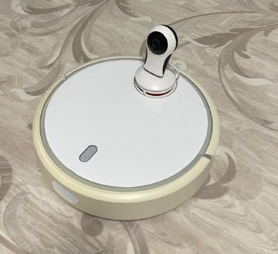
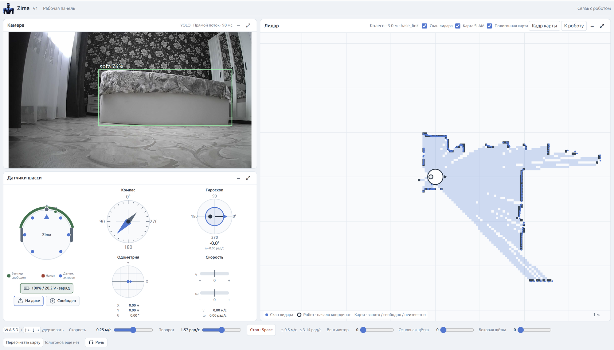

<h1 align="center">Zima</h1>

<p align="center"><b>Робото-пылесосом с камерой под управлением ИИ</b></p>

## Идея

В рассказе [Zima Blue](https://en.wikipedia.org/wiki/Zima_Blue_and_Other_Stories)
робот для чистки бассейна дорос до великого художника. 

Вдохновившись этим, я взял старый робот-пылесос Roborock V1, добавил камеру и отдал
управление языковой модели. Посмотрим, кто получится из него.

## Что есть у робота

<p align="center"></p>

На корпусе лидара стоит Wi-Fi камера с прошивкой OpenIPC, запитанная от его
5 В. Кадры разбирает YOLOE-26 на GPU, около 90 мс на кадр. Лидар на 360
градусов и SLAM строят карту помещения во время езды. Модель получает
телеметрию бампера, датчиков обрыва и отрыва, сонара, гироскопа, компаса
и батареи, командует колёсами, вентилятором и щётками и может говорить через
динамик пылесоса.

Все устройства доступны через MCP-сервер. ROS не используется. На хосте
работает один сервер на Rust, на роботе запущен небольшой супервизор,
драйвером железа остаётся штатный Player.

## Управление через MCP

Сервер поднимает эндпоинт `POST /mcp` (Streamable HTTP, JSON-RPC 2.0).

```sh
bin/zima run
claude mcp add --transport http zima http://127.0.0.1:8085/mcp
```

После этого модели можно дать задачу обычным текстом, например "осмотрись
и опиши, что видишь".

| Инструмент | Назначение |
| --- | --- |
| `robot_observe` | Состояние датчиков, лидар по 8 секторам, объекты с камеры |
| `robot_get_camera_frame` | JPEG-кадр с камеры |
| `robot_get_map` | Карта помещения из SLAM |
| `robot_acquire_control` / `robot_release_control` | Взять и отдать управление |
| `robot_drive_for` / `robot_stop` / `robot_get_action` | Ограниченное движение и его исход |
| `robot_recover_bumper` | Отъезд назад после упора в препятствие |
| `robot_reset_hazards` | Сброс блокировки после срабатывания датчиков |
| `robot_set_cleaning_motors` | Вентилятор и щётки |
| `robot_say` | Озвучить фразу |

## Ручное управление

Для ручного управления есть WEB дашборд на том же порту что и MCP (http://127.0.0.1:8085)

<p align="center"></p>


## Ограничения и безопасность

Наблюдать модель может всегда. Двигаться она может только с допуском
оператора, который задаётся переменной окружения
`ROBOT_MCP_GRANT=subject,max_linear_mps,max_angular_radps,max_action_ms,budget_ms,ttl_s`.
В нём записаны потолок скорости, длительность одного действия, общий бюджет
движения и срок действия. Выдать допуск себе модель не может.

Каждое движение ограничено по времени, и ноль на колёса отправляет супервизор
на самом роботе, даже если пропали хост или Wi-Fi. Срабатывание бампера,
датчика обрыва или отрыва блокирует движение до явного сброса. Скорость
ограничена 0.5 м/с и 3.14 рад/с, выполняется одно действие за раз.

Лидар не видит ступеньки и низкие предметы, распознавание объектов
не защищает от столкновений. Рядом с лестницами нужен присмотр человека.
Подробности в [HARDWARE.md](HARDWARE.md).

## Запуск

```sh
bash tools/build-supervisor.sh                            # супервизор для робота (ARM)
cargo build --manifest-path crates/Cargo.toml --release   # сервер для хоста
bin/zima run                                              # панель: http://127.0.0.1:8085
```

Нужны робот с root-доступом по SSH и приватный `etc/robot.toml` по шаблону
[`etc/robot.example.toml`](etc/robot.example.toml). Для карты и распознавания
нужны MRPT-адаптер и машина с GPU, без них запуск такой:
`bin/zima run --no-slam --no-yolo`.

`bin/zima run` забирает управление у штатного контроллера пылесоса.
Оператор видит в браузерной панели камеру, лидар, карту и датчики и может
управлять роботом с клавиатуры.

## Документация

* [HARDWARE.md](HARDWARE.md) - железо, датчики, питание, ограничения.
* [SOFTWARE.md](SOFTWARE.md) - архитектура, протоколы, контракт MCP, сборка.
* [CLAUDE.md](CLAUDE.md) - правила работы с репозиторием.
* [THIRD-PARTY-NOTICES.md](THIRD-PARTY-NOTICES.md) - сторонние компоненты.

История проекта описана в блоге:
[взлом прошивки](https://ermak.dev/blog/zima-blue-glm-protiv-openai/),
[установка камеры](https://ermak.dev/blog/zrenie-dlya-robota/),
[MCP и выбор модели](https://ermak.dev/blog/mozgi-dlya-robota/).

## Тесты

Наборы работают офлайн на локальных фейках, робот не нужен.

```sh
bash tests/test_robot.sh
bash tests/test_robot_camera.sh
python3 tests/test_robot_bug.py
shellcheck bin/zima bin/camera/snapshot tests/*.sh
```

## Лицензия

Код проекта распространяется под [MIT](LICENSE). Сторонние компоненты
перечислены в [THIRD-PARTY-NOTICES.md](THIRD-PARTY-NOTICES.md). Опциональный
YOLO-контур (`tools/yolo/`) подтягивает AGPL-зависимости при установке.
